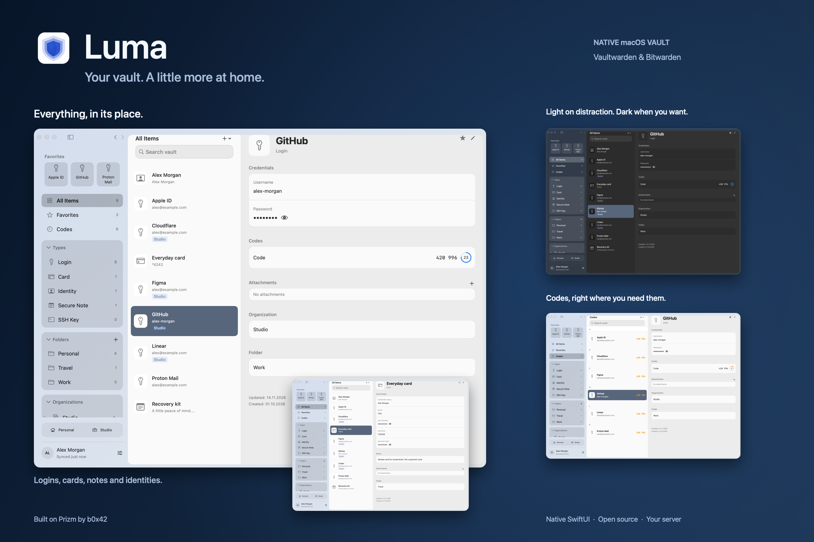
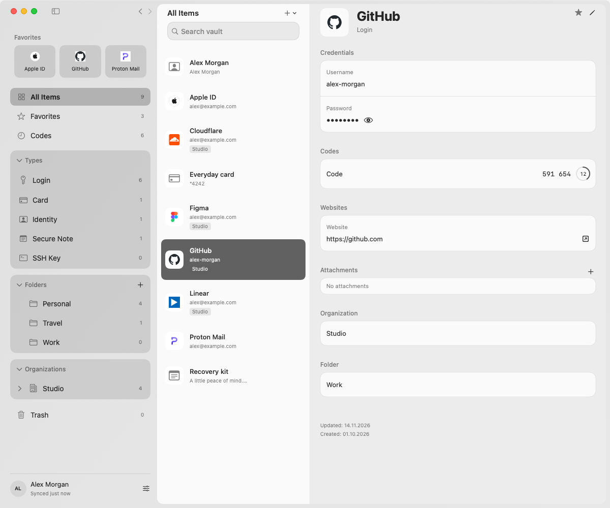
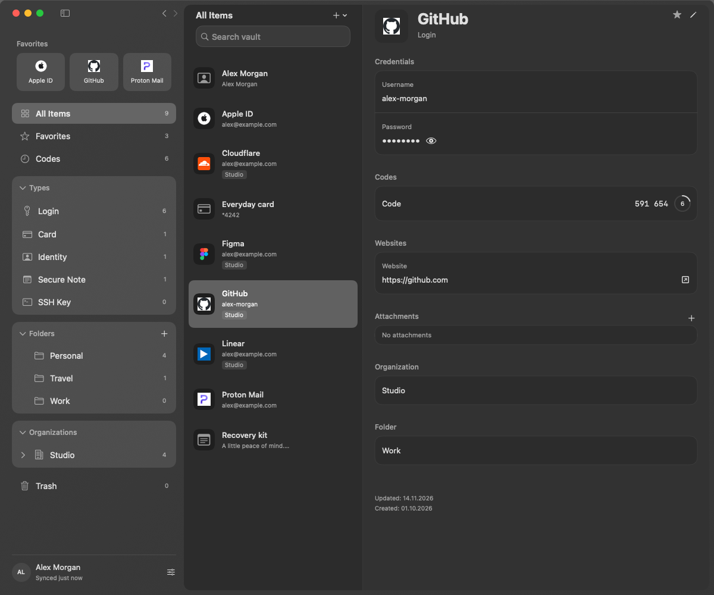
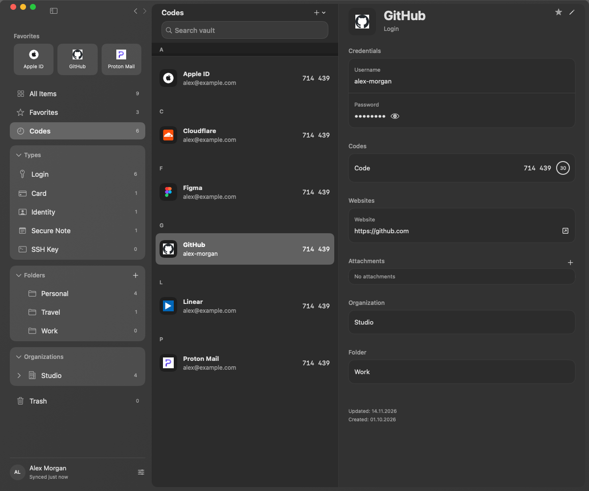
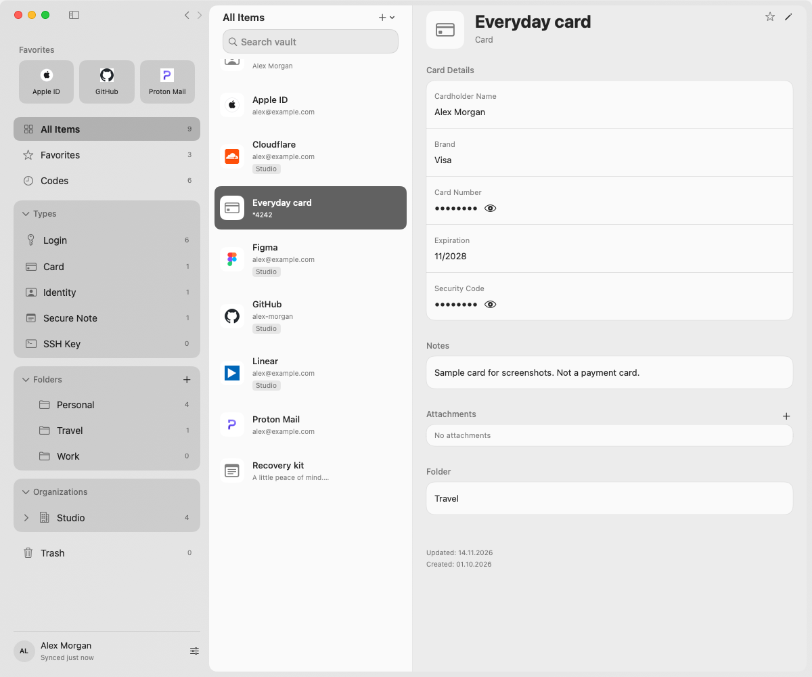

<div align="center">

# Luma

[](https://github.com/b0x42/prizm/actions/workflows/ci.yml)
[](https://swift.org/)
[](https://www.apple.com/macos/)
[](LICENSE)

Native macOS client for Vaultwarden and self-hosted Bitwarden, built in Swift.

*Your secrets. Your server. Our user interface.*

</div>

---

## About this fork

Luma is [André's fork, `sk2andy/prizm`](https://github.com/sk2andy/prizm), derived from [Prizm by Benjamin (`b0x42`)](https://github.com/b0x42/prizm). The original app, vault integration, and security architecture come from that project. Benjamin's copyright and the [MIT license with Commons Clause](LICENSE) are retained.

The `feat/arc-redesign` branch explores an Arc-inspired macOS interface: a tinted sidebar with favorite tiles, collapsible groups, organization navigation, and a profile footer. Search sits above the item list and covers the full vault across folders and organizations; selecting a sidebar category returns to browsing that category. Each column has its own minimum width, and the window minimum adjusts when the sidebar is hidden. Existing folders, organizations, collections, and item actions remain available.

The macOS 15 compatibility contribution is tracked separately in [upstream PR #88](https://github.com/b0x42/prizm/pull/88). This interface redesign belongs to this fork and is not part of that PR. Arc provides visual inspiration only; this fork is not affiliated with Arc or Bitwarden.

<div align="center">
  
</div>

### Screenshots

Actual app views using demonstration vault data.

| Login · Light | Login · Dark |
|---|---|
|  |  |
| **Verification codes** | **Card details** |
|  |  |

---

## Why Luma

The official Bitwarden desktop app is built with Electron — a Chromium-based web wrapper. It works, but it doesn't feel like a Mac app.

Luma builds on Prizm's approach: a fully native macOS client, built in SwiftUI, that connects to the same self-hosted Vaultwarden or Bitwarden server you already run. It looks and behaves like a real Mac app because it is one.

If you self-host your passwords and care about software quality on your own machine, Luma is for you.

### Mission & Principles

Luma carries forward Prizm's aim to give macOS users a native, auditable, trustworthy interface to their self-hosted password vault.

**Native-first.** SwiftUI with native AppKit controls where needed. No Electron or web views.

**Security-first.** No hand-rolled crypto. Every algorithm is a vetted standard with a public specification. Every security decision is documented so you can verify it.

**Radical transparency.** This is security software. You should be able to read the code, understand the cryptography, and decide whether to trust it. That's why it's open source and why the security documentation is thorough.

**Simple and honest.** Build what's needed. Say what's not supported. No dark patterns, no growth hacks, no telemetry.

## Features

- **Full vault management** — browse, create, edit, delete, and restore all item types (logins, cards, identities, secure notes, SSH keys) with Trash and favourites support
- **Organisation & collection support** — view and manage items across organisations; collections shown as a collapsible tree in the sidebar with item counts; create, rename, and delete collections (admin/manager role); org items encrypted with RSA-unwrapped organisation keys
- **Folder organization** — create, rename, and delete folders; nested subfolders via `/` naming convention with collapsible tree view; drag-and-drop items onto folders
- **Arc-inspired interface** — favorite tiles in the sidebar, an inset list and detail area, and full-vault search directly above the item list
- **Built for power users** — ⌘F global search with match highlighting, ⌘N new item, ⌘L lock, one-keystroke copy for username / password / website, Option to reveal masked fields. [Full shortcut list](#shortcuts)
- **File attachments** — upload, download, open, and delete encrypted file attachments on any vault item; drag-and-drop batch upload; two-layer AES-256-CBC + HMAC-SHA256 encryption with per-attachment keys
- **Verification codes (TOTP)** — see the current one-time code for any login with a TOTP seed, in the item and in a "Codes" list in the sidebar; codes rotate automatically with a countdown, and ⌃⌘C copies the current code (cleared after 30 s). The raw seed is never shown or copied
- **Password & passphrase generator** — configurable length, character sets, and word separators
- **Touch ID / Face ID unlock** — unlock your vault with biometrics; auto-prompts on lock; graceful re-enrollment when fingerprints change
- **Auto-lock** — locks on sleep and screensaver; sync status always visible in the sidebar
- **Accessible** — VoiceOver labels and hints on all controls, keyboard navigable, respects Reduce Motion and Increase Contrast; targets WCAG 2.1 AA. See [ACCESSIBILITY.md](ACCESSIBILITY.md)

## Install

### Requirements

- macOS 15 (Sequoia) or later
- A self-hosted [Vaultwarden](https://github.com/dani-garcia/vaultwarden) or [Bitwarden](https://bitwarden.com/) server

Tested against Vaultwarden 1.35.4. Older versions may work but are not validated.

### Build this fork from source

The redesigned fork is currently a source build; no binary release is provided here. Building requires Xcode 26 and macOS 15.6 or later; the built app supports macOS 15.0 or later.

```bash
git clone --branch feat/arc-redesign https://github.com/sk2andy/prizm.git
cd prizm
cp Prizm/LocalConfig.xcconfig.template Prizm/LocalConfig.xcconfig
# Fill in your Apple Team ID in LocalConfig.xcconfig, then:
open "Prizm/Prizm.xcodeproj"
```

See [DEVELOPMENT.md](DEVELOPMENT.md) for signing and build instructions, including how to get a free Team ID. Use the fork and branch above instead of the upstream clone command in that guide.

Luma uses its own bundle ID (`de.sk2andy.Luma`) and Keychain services, independently of Prizm. Sign successive local builds with the same Apple Development team to retain Keychain access across updates. Ad-hoc and self-signed builds can trigger new Keychain authorization prompts after each rebuild. A free Personal Team works for local development; its provisioning profile expires after seven days and needs a fresh signed build.

### Original upstream app

The [upstream releases](https://github.com/b0x42/prizm/releases) and Homebrew commands below install Benjamin's original Prizm, **not this fork's redesigned interface**. Check the upstream release notes for its macOS requirements.

```bash
brew tap b0x42/prizm
brew install --cask prizm
```

## Privacy & Security

Luma collects nothing. No telemetry, no analytics, no crash reporting, no usage data. There is no Luma server — the app talks exclusively to your Vaultwarden or Bitwarden instance. Nothing leaves your server.

All cryptography runs locally on your device:

- **Argon2id key derivation** (RFC 9106, memory-hard) — makes offline brute-force attacks computationally infeasible
- **AES-256-CBC + HMAC-SHA256** authenticated encryption — encrypted vault payloads; entries are decrypted locally while the vault is unlocked
- **RSA-OAEP-SHA1 organisation key unwrapping** (Security.framework) — organisation symmetric keys are RSA-wrapped per member; Luma unwraps them at sync time using your account's private key, following the Bitwarden protocol
- **macOS Keychain** storage (device-only, `WhenUnlockedThisDeviceOnly`) — session keys never touch iCloud

The app is open source. Verify these claims by reading the code. See [SECURITY.md](SECURITY.md) for the full threat model, algorithm specifications, and what the app does not protect against. See [ACCESSIBILITY.md](ACCESSIBILITY.md) for the WCAG 2.1 conformance statement.

## Shortcuts

| Shortcut | Action |
|---|---|
| ⌘F | Global search |
| ⌘K | Focus vault search directly |
| ⌘[ / ⌘] | Back / forward through visited categories and items |
| ⌘B | Show or hide sidebar |
| ⌘N | New item |
| ⌘L | Lock vault |
| ⌘E | Edit selected item |
| ⌘S | Save edits |
| ⇧⌘C | Copy username |
| ⌥⌘C | Copy password |
| ⌥⇧⌘C | Copy website |
| ⇧⌘Q | Sign out |
| ⌥ (hold) | Reveal masked fields |

Any shortcut can be remapped in **System Settings → Keyboard → Keyboard Shortcuts → App Shortcuts**. Add a rule for Luma with the exact menu item name and your preferred key combination.

## Development direction

This fork focuses on the interface redesign described above. The [original project's roadmap](https://github.com/b0x42/prizm#roadmap) belongs to upstream and is not a delivery commitment for this fork. Report fork-specific issues in [sk2andy/prizm](https://github.com/sk2andy/prizm/issues).

## Known Limitations

- **Not notarized** — The app is not signed with an Apple Developer ID. On first launch, right-click and choose Open to bypass Gatekeeper.
- **No browser auto-fill** — There is no browser extension. Copy-paste is the current workflow.
- **Passkeys not supported** — SSH key items are viewable but passkey-based login is not implemented.
- **No offline vault creation** — Creating or editing items requires an active server connection.
- **Attachment size limit** — Files larger than 500 MB are rejected. Bitwarden-hosted servers require a premium subscription for attachments; Vaultwarden is unaffected.

## Contributing

See [DEVELOPMENT.md](DEVELOPMENT.md) for prerequisites, build instructions, and the architecture overview.

Changes follow an **openspec** workflow: each feature lives in `openspec/changes/<name>/` with a proposal, design, and task list before any code is written. See `openspec/` for active and archived changes.

Pull requests welcome. Please open an issue first for anything significant.

---

*Not affiliated with Arc, The Browser Company, Bitwarden, Inc., 8bit Solutions LLC, or the Vaultwarden project.*
